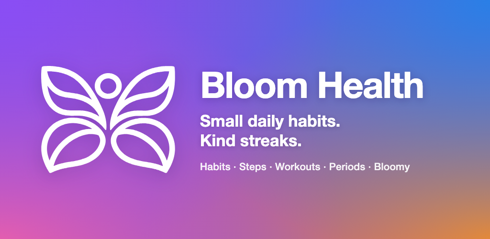
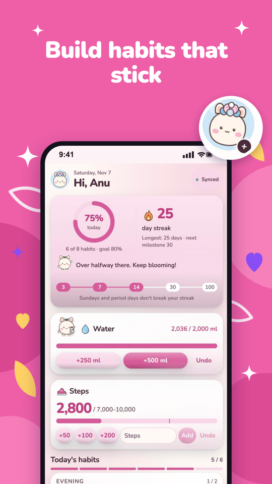
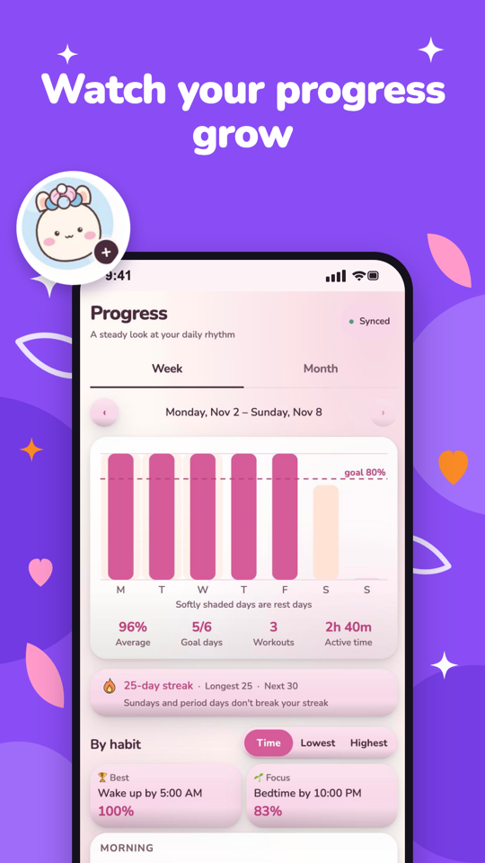
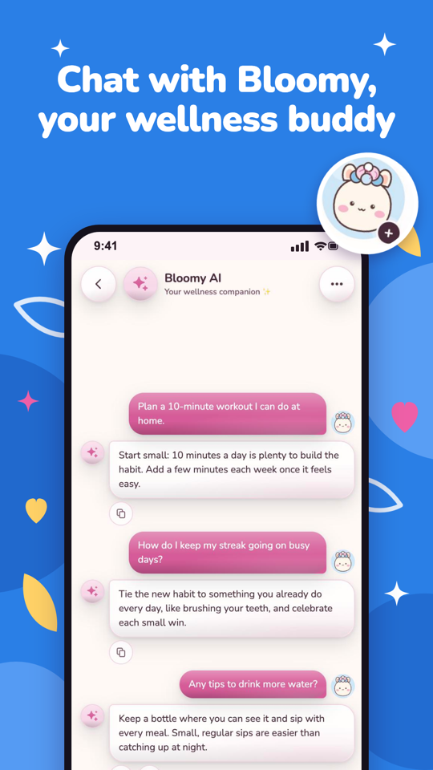
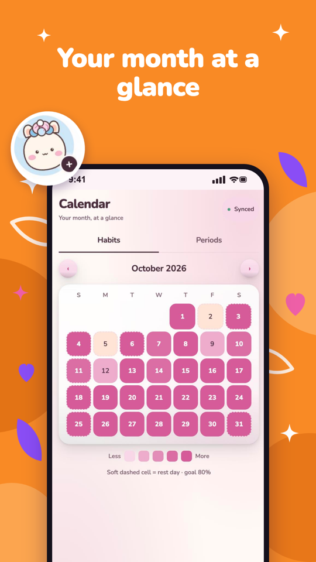
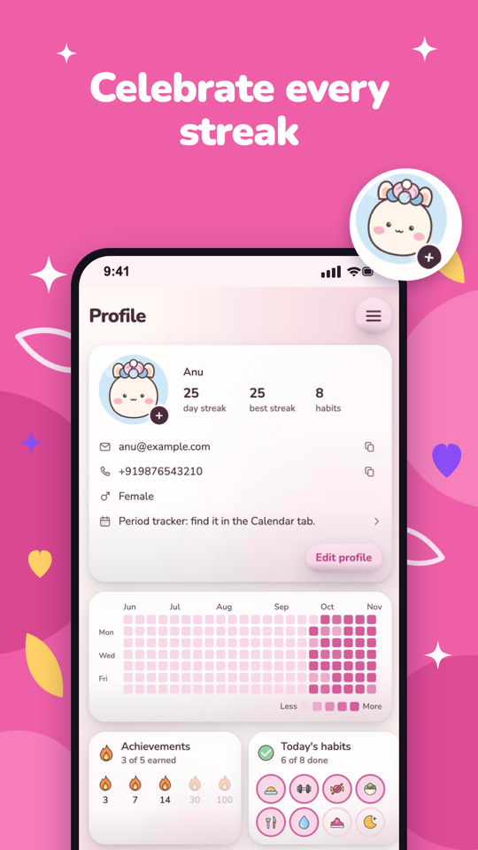
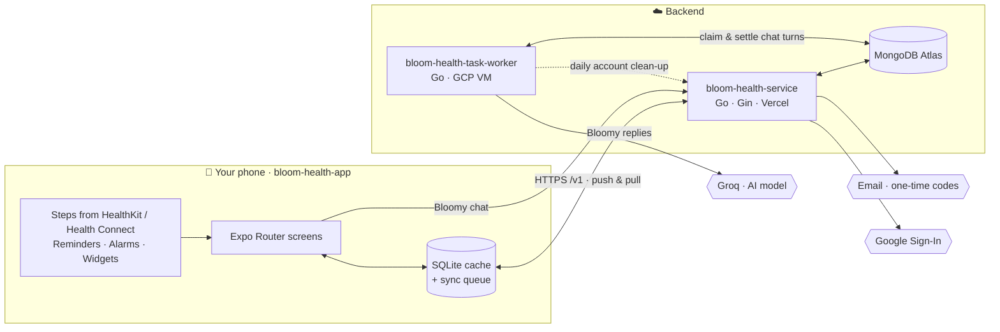
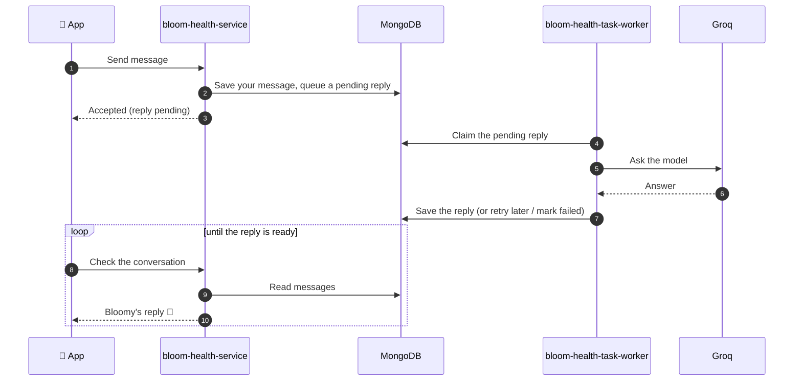

  

<h3 align="center">Small daily habits. Kind streaks.</h3>

  Bloom Health is a gentle habit and wellness tracker for Android and iOS. 
  Log water, steps, workouts and your daily habits, keep a streak that forgives rest days, 
  and chat with <b>Bloomy</b>, a friendly AI companion — on your own or with someone cheering you on.

  
  
  
  
  

---

### ✨ What you can do

- **🌱 Daily habits** — start with 8 ready-made habits or create your own, schedule them by weekday, and set a daily goal (80% by default).
- **💧 Water & steps** — one-tap logging with quick-add buttons and progress toward your target.
- **🏋️ Workouts** — a timer that keeps running even if the app is closed, plus manual entries.
- **🔥 Kind streaks** — Sundays and rest days never break your streak. Milestones at 3, 7, 14, 30 and 100 days.
- **📅 Calendar & progress** — a monthly calendar, weekly chart and heatmap to see how far you've come.
- **🌸 Period tracker** — private cycle logging with flow, symptoms and mood, and a gentle estimate of your next cycle. Never shared with viewers.
- **💬 Bloomy** — an AI chat companion for encouragement and habit ideas.
- **👀 Invite a viewer** — let a partner, friend or family member follow your progress, read-only.
- **⏰ Reminders** — as a notification, a tone or a loud alarm.
- **📱 Home-screen widgets** — streak, daily progress, and steps & calories (Android).
- **🎨 Make it yours** — 15 Bloom avatars and five themes, each in light and dark.

### 🔒 Private by design

- Sign in with a one-time code — no passwords to remember.
- Works offline: everything saves on your phone first and syncs when you're back online.
- Viewers can only look, never edit, and never see your period data.

### 🧩 How it's built

| Repository | Role | Stack |
|---|---|---|
| `bloom-health-app` | The mobile app (offline-first, with a local sync queue) | Expo · React Native · TypeScript · SQLite |
| [`bloom-health-service`](https://github.com/BloomHealthApp/bloom-health-service) | REST + sync API, OTP auth, owner/viewer access | Go · Gin · MongoDB Atlas |
| `bloom-health-task-worker` | Background worker for Bloomy chat and scheduled jobs | Go · MongoDB · GCP |

### 🏗️ Architecture

### 🔄 How data flows

**Offline-first sync.** Everything you log is saved to SQLite on your phone first and added to a sync queue. When you're online, the app *pushes* queued changes. Each change has its own id, so a retry never applies it twice. Then it *pulls* everything new since its last cursor. If the same record was changed in two places, a version check settles it the same way every time.

**Sign-in.** Enter your phone or email and you get a one-time code by email, or you can sign in with Google. The service returns a short-lived access token and a refresh session. There are no passwords anywhere.

**Bloomy chat.** The app never calls the AI model itself. The service queues the turn in MongoDB, and the worker picks it up:

Each chat allows one reply in flight at a time. Every user has a daily message cap, and retries back off when the model is busy.

### 🔐 Privacy built in

- **Period data stays with you.** The server filters it out for viewers, both in sync and in stats.
- **No health data goes to the AI.** Bloomy only sees your chat.
- **Chat text is never logged**, by the service or the worker.
- **No secrets on your phone.** Model and database keys live only on the servers.

---

  Bloom Health is a personal habit tracker, not medical advice. · Made with 💜 by <a href="https://github.com/amankumar-2001">Aman Kumar</a>

